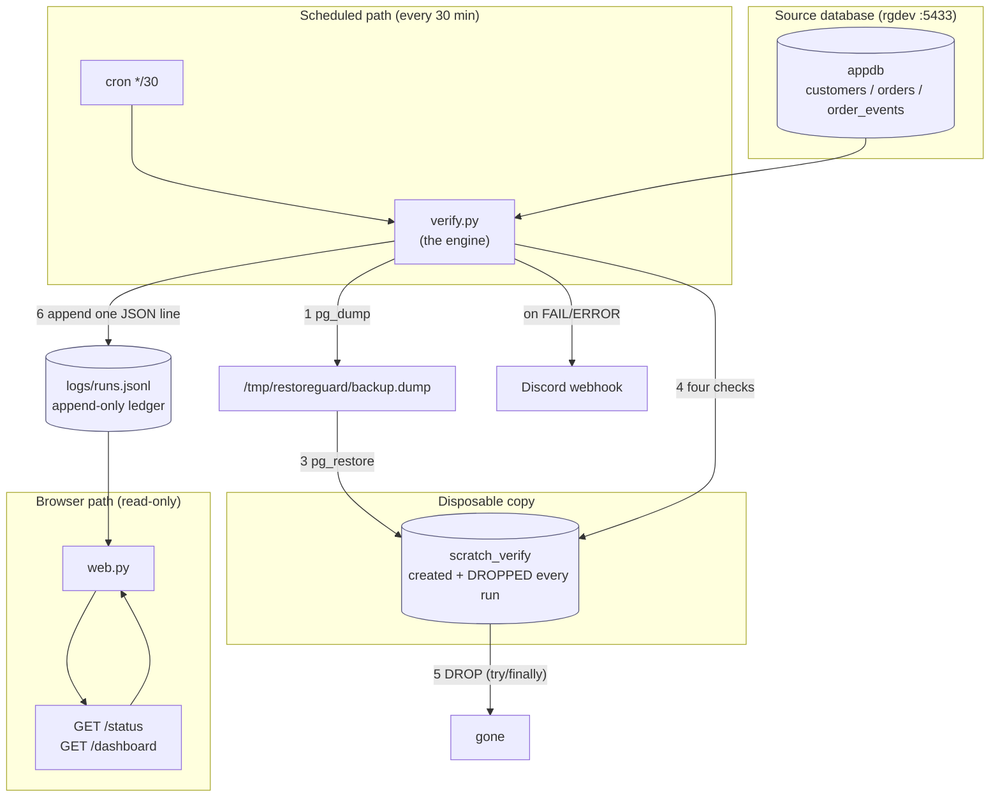

# RestoreGuard — Review Guide

Everything you need to explain the project in one sitting. Read it top to
bottom once, then use §11 (the cheat-sheet) and §9 (the live demo) on the day.

---

## 1. The one-line pitch

> **A backup you have never restored is not a backup — it's a hope.**
> RestoreGuard restores the database into a throwaway copy every 30 minutes,
> checks the copy four ways, deletes the copy, and alerts you the moment the
> backup stops being good.

Say that first. Everything else is detail.

---

## 2. The problem it solves

Most teams back up their database and never test the backup. The failure mode
is cruel: you discover the backup was broken on the day you need it — during
an outage, under pressure. RestoreGuard moves that discovery to a quiet
Tuesday at 3am, automatically.

Three things can be wrong with a backup, and they need different checks:

1. **It won't restore at all** (corrupt file, version mismatch) — a
   *pipeline* problem.
2. **It restores but the data is broken** (missing tables, orphans, empty
   tables) — a *data* problem.
3. **It restores fine but it's stale** — the source stopped writing days ago,
   so the backup faithfully preserved garbage.

RestoreGuard detects all three. §4 explains how it names the difference.

---

## 3. Architecture

**Two entry points, one shared file.** This is the whole design in one idea.



**Why one shared file matters:** `verify.py` writes `logs/runs.jsonl` and
`web.py` reads it. There is no database of results, no cache, no message
queue — one append-only file is the single source of truth. That removes an
entire class of "the dashboard disagrees with the log" bugs. There is nothing
to keep in sync because there is only one copy.

---

## 4. The three outcomes — PASS / FAIL / ERROR

This is the concept reviewers love, because it shows the code models reality.

| Outcome | Meaning | Who's at fault | Example trigger |
|---|---|---|---|
| **PASS** | dump + restore + all 4 checks succeeded | nobody | healthy run |
| **FAIL** | pipeline worked, a **check** says the data is bad | the *data* | stale source, missing table |
| **ERROR** | the **pipeline** broke; checks may not have run | the *tooling* | corrupt dump, version mismatch |

`FAIL` → "your data needs a human". `ERROR` → "the tool couldn't do its job".
Keeping them separate is what stops alert fatigue: you don't wake up for a
`FAIL`, but you absolutely do for an `ERROR`. In the demo, the stale source
produces `FAIL` (the pipeline was fine, the data wasn't) while the corrupt
dump produces `ERROR` (the pipeline itself broke).

---

## 5. Routing

`web.py` is a small **read-only** Flask app with exactly two routes. There is
nothing to authenticate because nothing can be changed.

| Method | Route | Returns | Read by |
|---|---|---|---|
| GET | `/status` | JSON | machines — a monitor, a probe, `curl` |
| GET | `/dashboard` | HTML | humans — the "inspection certificate" |
| GET | `/static/style.css` | CSS | the browser (served by Flask's static handler) |

**How the mapping happens.** Flask matches the URL path to a view function:

```python
@app.route("/status")
def status():
    return jsonify(build_status())

@app.route("/dashboard")
def dashboard():
    return render_template("dashboard.html", status=build_status(), runs=read_runs(10), refresh=30)
```

**Why `/status` returns JSON.** A machine needs structure, not pixels. A
monitor runs `curl .../status` and reads `state`; if it isn't `"PASS"`, alert.
`build_status()` builds that dict field-by-field from an **explicit
allow-list** rather than spreading the raw log record — so if someone later
adds a sensitive field to the log, it does not automatically leak to the
internet.

**Why `/dashboard` doesn't hardcode the CSS path.** The template uses:

```html
<link rel="stylesheet" href="{{ url_for('static', filename='style.css') }}">
```

`url_for` asks Flask to generate the URL for its own `static` endpoint. If
the app is ever deployed under a prefix (`/restoreguard/`), every URL updates
automatically. Hardcoding `/static/style.css` would break — this is the
correct, framework-native way.

**Auto-refresh without JavaScript.** The dashboard includes a meta refresh,
but *guarded*:

```html
<meta http-equiv="refresh" content="{{ refresh }}">
```

`refresh=30` means the page reloads every 30s on its own. The ``
guard matters: `content="0"` would reload forever in a tight loop, so a falsy
value must render *nothing*, not zero.

**Where `static/` must live.** Flask's convention is mandatory: the folder is
named `static/`, sits as a sibling of `templates/`, and `url_for('static', ...)`
resolves to it. Move or rename it and every asset 404s.

---

## 6. Control flow of one run (`verify.py: run()`)

```
run()
 ├─ record = {run_id, started_at, host, outcome:"ERROR", checks:[], scratch_dropped:False, ...}
 ├─ try:
 │    0. check_client_version()      # fail fast on client/server major mismatch
 │    1. record["dump_bytes"] = dump()          # pg_dump -Fc
 │    2. create_scratch()                        # DROP IF EXISTS + CREATE
 │    3. restore()                               # pg_restore --exit-on-error
 │    4. conn = connect(SCRATCH)
 │       for check in CHECKS: run it, append result, print PASS/FAIL
 │       outcome = PASS if all passed else FAIL
 ├─ except Exception as exc:
 │       outcome = ERROR ; record["error"] = str(exc)
 └─ finally:                                     # ← RUNS NO MATTER WHAT (FR10)
        close conn
        5. drop_scratch()  -> scratch_dropped = True
        duration_seconds = ...
        log_run(record)                            # append to runs.jsonl
        if outcome != PASS: send_alert(record)     # Discord
 return 0 if PASS else 1
```

Two things to point at:

- **The `finally` block is the promise.** `drop_scratch()` runs even if the
  restore threw. That's why every line in the ledger — including the ERRORs —
  has `scratch_dropped: true`. You can *prove* this: the demo shows an ERROR
  run still printing `dropped`.
- **Exit code is the interface.** `return 0 if PASS else 1`. cron, CI, or any
  monitor can act on the exit code alone without parsing any output.

---

## 7. File-by-file (what to say about each)

### `restoreguard/verify.py` — the engine
The only file that changes state. Sections, top to bottom:

- **Settings** — module-level constants read once from `.env` via
  `load_dotenv(ROOT / ".env")`. `ROOT = Path(__file__).resolve().parent.parent`
  means it works no matter the current directory (cron starts in `/`).
- **`pg_env()`** — the environment for `pg_dump`/`pg_restore`. Sets
  `PGPASSWORD` (no prompt) and **prepends `PG_CLIENT_BIN` to `PATH`** so the
  pinned client always wins. This is the fix for the version trap (§8).
- **`connect()`** — `autocommit=True` so one failed statement can't poison
  the connection; `connect_timeout=10` so a dead host fails in 10s, not
  forever.
- **`_run(cmd, env)`** — runs a pg command and, on failure, raises
  `RuntimeError` **including stderr**. `subprocess.run(check=True)` would only
  say "exit status 1" and hide the reason — useless in an alert.
- **`_client_major()` / `_server_major()` / `check_client_version()`** — the
  guard. Asks the *actual* binary (through `pg_env()`) what version it is, and
  the server via `SHOW server_version_num` (160015 → //10000 → 16).
- **`dump()`** — `pg_dump --format=custom`. Also honours the
  `RESTOREGUARD_DEMO_CORRUPT` switch used by demo A.
- **`create_scratch()` / `restore()` / `drop_scratch()`** — the disposable
  copy's lifecycle. `restore()` uses `--exit-on-error`. `drop_scratch()`
  terminates other backends first because `DROP DATABASE` refuses while any
  connection is open.
- **`_result()` + the four checks** — each takes a connection, returns
  `{name, passed, detail}`. They never raise; a missing table becomes a clean
  `unreadable (...)` FAIL. `CHECKS = [check_tables, check_row_counts,
  check_integrity, check_freshness]` drives the loop.
- **`log_run()` / `send_alert()` / `run()`** — append the JSON line, POST to
  Discord if configured, and the orchestrator in §6.

### `restoreguard/web.py` — the read-only view
~70 lines. `read_runs(limit)` reads the JSONL newest-first and **skips
malformed lines** rather than crashing. `build_status()` returns the
allow-listed summary. Two routes (§5). No state, no database, no writes.

### `restoreguard/templates/dashboard.html`
A Jinja template, zero JavaScript. Renders a rotated PASS/FAIL "stamp", four
figures, the latest check breakdown, and a 10-row ledger table with a
"scratch left behind" chip — which makes acceptance criterion #4 (scratch
always dropped) visible at a glance.

### `restoreguard/static/style.css`
Extracted from the template (browser-cached, presentation separated from
markup). Design metaphor: a printed **inspection certificate** — paper
background, hairline rules, mono tabular numerals. The *only* colour is the
pass/fail signal. Deliberately not dark-mode.

### `sql/schema.sql` / `sql/refresh.sql`
`schema.sql` builds the sample source: three tables in a chain
(`customers ← orders ← order_events`) with 50 / 200 / 600 rows. The chain is
what makes the integrity check meaningful. `refresh.sql` simulates app writes
by re-stamping `occurred_at`, standing in for the writes a real source keeps
doing.

### `tests/test_restoreguard.py`
20 tests, no database needed. The checks take a connection and return a dict,
so the tests hand them a **fake connection** scripted with chosen values. The
web tests point `LOG_PATH` at a temp file via `monkeypatch`. Covers the
version guard, all four checks (including the defensive paths), the log
reader, and both routes.

### `.github/workflows/ci.yml`
Runs the tests on Python 3.12 against a `postgres:16` service — deliberately
the same major as production, so a version drift fails in CI.

### `demo.sh`
Plays the three scenarios (healthy → corrupt → stale) plus a final reset,
back-to-back for the live demo.

---

## 8. The hard-won details (these are the "senior" answers)

**The version trap.** A Postgres *client* can read a newer *server* over the
wire, but `pg_dump`/`pg_restore` enforce the **archive format**, which is
versioned. Too-old client → `unsupported version (1.15) in file header`.
Too-new client → writes `SET transaction_timeout = 0;` (a PG17-only setting)
and a PG16 server rejects it with `unrecognized configuration parameter`.
So the client and server **majors must equal**, and the app checks this at the
top of every run with a message that names the fix.

**Why `--format=custom`.** A plain `.sql` dump would half-restore and look
fine. The custom archive format makes a truncated or damaged file
*detectably* invalid — which is exactly what makes demo A possible.

**Why `--exit-on-error` on restore.** By default `pg_restore` reports errors
and keeps going, exiting 0. That would make a broken restore look successful.
`--exit-on-error` stops at the first problem and exits non-zero. This flag
*is* the feature, not a liability.

**Why `autocommit=True`.** Without it, a single failed statement poisons the
transaction and every later query errors too, masking the real cause.

**Why terminate backends before DROP.** `DROP DATABASE` fails while any
connection is open. The code disconnects everyone else, then drops — the
difference between a clean run and a leak.

**Why freshness looks at one table only.** `order_events` writes constantly.
`customers` could legitimately be quiet for weeks, so checking it would
produce false alarms. Freshness must be measured on the high-write table.

**Why the checks never raise.** A check should *fail*, not *explode*. If a
dropped table made a check throw, the whole run would become `ERROR` with only
some checks logged — misleading. Each check returns its own verdict so one bad
table produces four clear FAILs, not a crash.

---

## 9. The live demo (say this, type this)

Open **two terminals** in `/Users/tejaskunta/RestoreGuard`.

**Terminal 1** — watch the ledger:

```
tail -f logs/runs.jsonl
```

**Terminal 2** — run everything:

```
make demo
```

Narration as the three scenarios scroll by:

1. **Healthy** — *"Four PASS. This is the normal path: dump, restore, four
   checks, scratch dropped."*
2. **Corrupt** — *"I truncated the dump to 1KB. It's an ERROR — and notice it
   still says `dropped`. Even when the restore explodes, the cleanup ran.
   That's the `finally` block."*
3. **Stale** — *"This is the important one. Three PASS, one FAIL — only
   freshness. The pipeline was perfect; the **data** was bad. No other check
   catches a frozen source."*
4. **Reset** — *"And it recovers. Green again."*

Then point at the summary the script prints:

> **"every run dropped its scratch DB: True" — including the ERROR runs.**

Finally, show the frontend:

```
.venv/bin/python -m restoreguard.web
```

Open `http://127.0.0.1:5001/dashboard` — *"the inspection certificate: verdict
stamp, figures, check breakdown, and the last ten runs. Auto-refreshes every
30 seconds, no JavaScript."* And the machine view:

```
curl -s http://127.0.0.1:5001/status
```

**Backup demo** (if the live one misbehaves): the ledger already contains
PASS, FAIL, and ERROR records — just `cat logs/runs.jsonl`.

---

## 10. Whiteboard sketch

Draw this and talk through it:

```
  cron (*/30)
      |
      v
  verify.py ── pg_dump ──> backup.dump
      |                         |
      |                         v
      |                    scratch_verify   <── created here
      |                         |
      |                   4 checks (tables, counts, integrity, freshness)
      |                         |
      |                    DROP scratch      <── try/finally: ALWAYS
      |
      ├──> logs/runs.jsonl  (append-only, single source of truth)
      |            |
      |            v
      |        web.py ──> /status (JSON) + /dashboard (HTML)
      |
      └──> Discord  (only on FAIL/ERROR)
```

---

## 11. Cheat-sheet — the facts to have ready

**Numbers**
- Runs every **30 minutes** (cron `*/30`).
- **4** checks. **3** possible outcomes. **2** routes. **2** Python files.
- Local DB port **5433** (5432 is another project). Client & server major **16**.
- Sample data: **50** customers, **200** orders, **600** order_events.

**The four checks:** `tables_exist`, `row_counts`, `integrity`, `freshness`.

**The three outcomes:** PASS, FAIL (data bad), ERROR (pipeline broke).

**The two routes:** `/status` (JSON, machines), `/dashboard` (HTML, humans).

**Sentences to have ready:**
- *"A backup you never restored is a hope."*
- *"The scratch database is dropped in a `finally`, so it's dropped even on
  failure — you can see every ledger line has `scratch_dropped: true`."*
- *"FAIL means the data is bad; ERROR means the pipeline broke. Keeping them
  apart is what stops alert fatigue."*
- *"The client and server majors must match because the dump archive format
  is versioned — too old says 'unsupported version', too new writes a
  PG17-only setting the PG16 server rejects."*
- *"A check should fail, not explode — each check returns a verdict so one
  broken table gives four clear FAILs instead of one ERROR."*
- *"`url_for('static', filename=...)` so the asset URL follows the app
  wherever it's deployed — never hardcode `/static/`."*
- *"`logs/runs.jsonl` is append-only and is the single source of truth for
  both the JSON and the dashboard — there's nothing to keep in sync."*

**Likely questions → short answers**
- *Why Python and not a bash script?* → real `try/finally` cleanup, testable
  functions, structured JSON logging.
- *What if the dump is fine but the DB is empty?* → `row_counts` FAILs (and
  `tables_exist`/`integrity` likely with it).
- *Does it ever delete the source?* → No. It only ever *reads* the source;
  the only database it drops is `scratch_verify`, which it created.
- *Could two runs collide?* → They'd contend on the same `scratch_verify`
  name; at `*/30` the risk is negligible, and the next run recreates it anyway.
- *Where are secrets?* → `.env`, gitignored. AWS Secrets Manager is documented
  future work.
- *How would you know RestoreGuard itself died?* → `/status` returns `unknown`
  when there are no runs, and the dashboard says "no runs recorded yet" — a
  dead man's switch can poll that.
- *Why not test the whole thing end-to-end in CI?* → The CI runs a real
  `postgres:16` service so an E2E stage can be added; today the unit tests
  deliberately avoid a database to stay fast.
